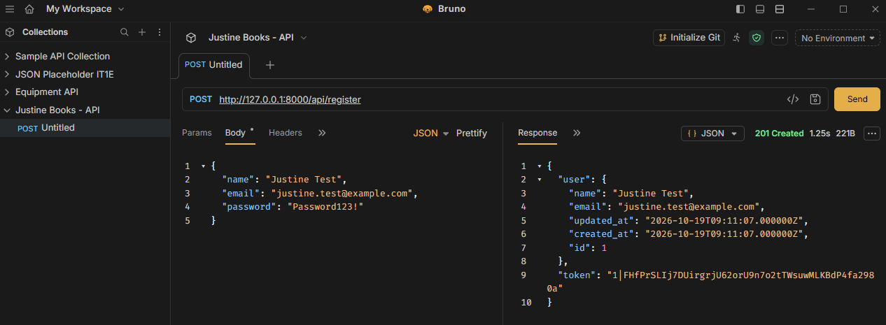
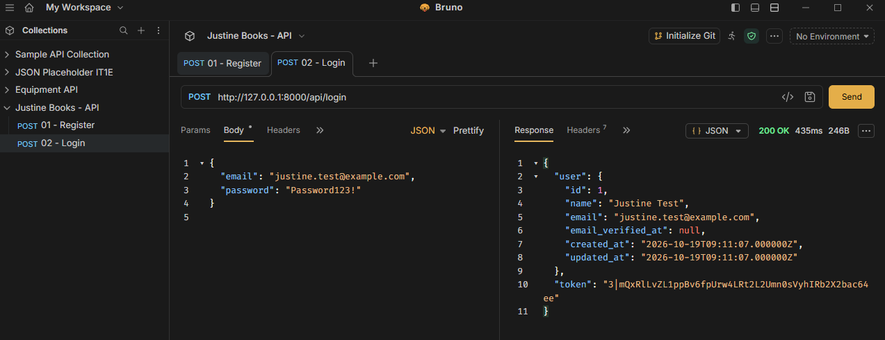
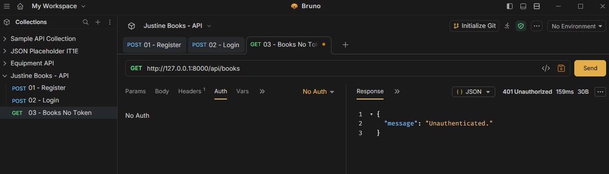
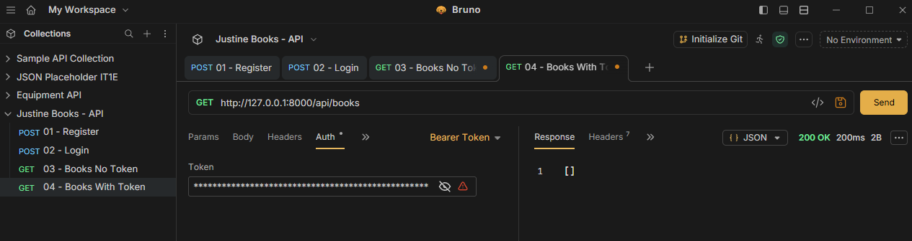
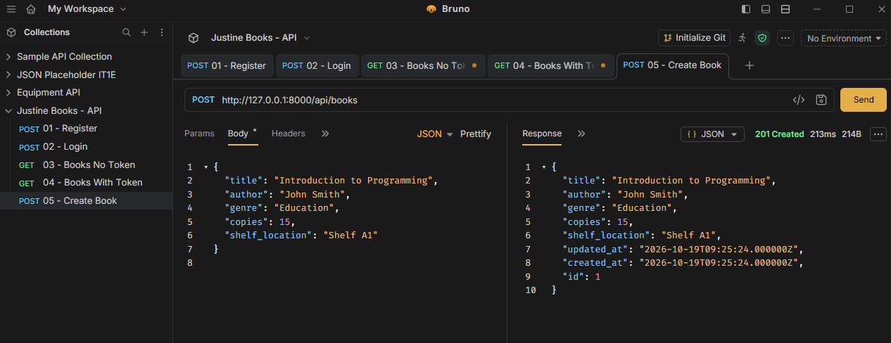
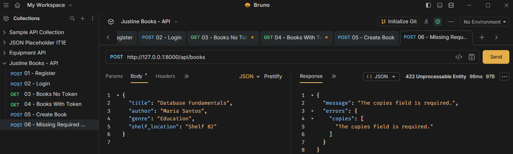
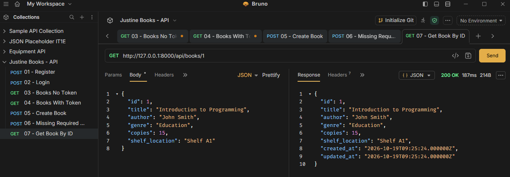
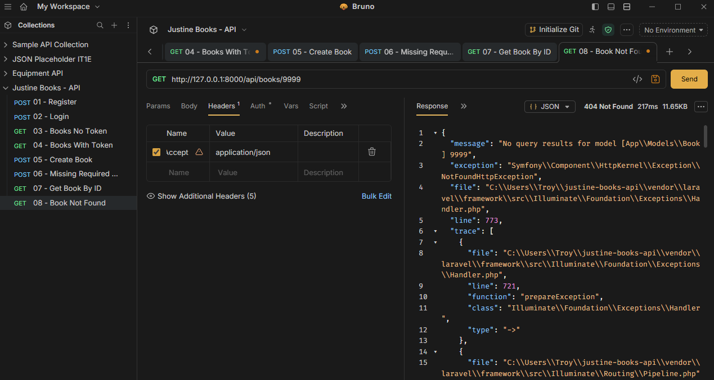
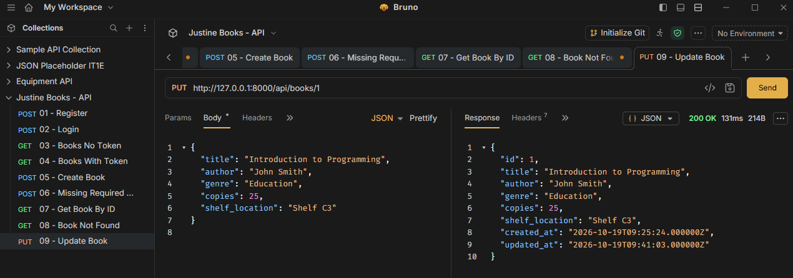
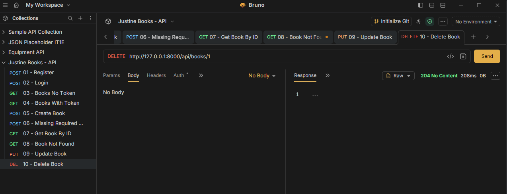

# Library Books Management API

**Course:** CIT 3102 – Systems Integration and Architecture  
**Activity:** Module 5 – Build an API  
**Student:** Justine T. Bimeda  
**Section:** IT1E  
**Resource:** Books

## 1. Project Description

The Library Books Management API is a RESTful API built using Laravel 13, SQLite, and Laravel Sanctum.

The system allows authenticated users to create, view, update, and delete book records. It also supports filtering books by genre and shelf location.

### Books Database Fields

| Field | Data Type | Description |
|---|---|---|
| title | String | Title of the book |
| author | String | Author of the book |
| genre | String | Category or genre |
| copies | Integer | Number of available copies |
| shelf_location | String | Location of the book |

The `copies` field must be a non-negative integer.

## 2. Installation and Setup

### Requirements

- PHP compatible with Laravel 13
- Composer
- SQLite
- Laravel 13
- Bruno API Client

### Setup Instructions

**Step 1: Clone the repository**

```bash
git clone <REPOSITORY_URL>
cd <REPOSITORY_FOLDER>
```

**Step 2: Install dependencies**

```bash
composer install
```

**Step 3: Configure the environment**

Copy `.env.example` to `.env`.

On Windows Command Prompt:

```cmd
copy .env.example .env
```

Generate the application key:

```bash
php artisan key:generate
```

**Step 4: Configure SQLite**

Set the following in `.env`:

```env
DB_CONNECTION=sqlite
```

Ensure that the `database/database.sqlite` file exists. Create an empty file if needed.

**Step 5: Run database migrations**

```bash
php artisan migrate
```

**Step 6: Start the Laravel server**

```bash
php artisan serve
```

The API runs at:

`http://127.0.0.1:8000`

## 3. API Routes

### Authentication Routes

| Method | Endpoint | Description | Authentication |
|---|---|---|---|
| POST | /api/register | Register a user | Public |
| POST | /api/login | Login and generate token | Public |
| POST | /api/logout | Revoke current token | Required |
| GET | /api/me | View authenticated user | Required |

### Books CRUD Routes

| Method | Endpoint | Description | Authentication |
|---|---|---|---|
| GET | /api/books | View all books | Required |
| POST | /api/books | Create a new book | Required |
| GET | /api/books/{book} | View a book by ID | Required |
| PUT | /api/books/{book} | Update a book | Required |
| DELETE | /api/books/{book} | Delete a book | Required |

**Total: 9 API routes**

All protected endpoints require a Laravel Sanctum Bearer token.

### Filtering

The Books API supports filtering by two whitelisted fields:

- `genre`
- `shelf_location`

Example requests:

```http
GET /api/books?genre=Education
GET /api/books?shelf_location=Shelf%20A1
```

### Sample Book JSON

```json
{
  "title": "Introduction to Programming",
  "author": "John Smith",
  "genre": "Education",
  "copies": 15,
  "shelf_location": "Shelf A1"
}
```

## 4. Bruno API Testing Screenshots

The following screenshots demonstrate the API requests and their expected HTTP response codes.

### Test 1 — Register User (201 Created)



### Test 2 — Login User (200 OK)



### Test 3 — Books Without Token (401 Unauthorized)



### Test 4 — Books With Token (200 OK)



### Test 5 — Create Book (201 Created)



### Test 6 — Missing Required Field (422 Unprocessable Entity)



### Test 7 — Get Book by ID (200 OK)



### Test 8 — Book Not Found (404 Not Found)



### Test 9 — Update Book (200 OK)



### Test 10 — Delete Book (204 No Content)



## 5. HTTP 204 No Content Explanation

The HTTP 204 No Content status means that the server successfully processed the request but does not return a response body. In this project, it is used when a book record is successfully deleted. The response is intentionally empty because the deleted book's information does not need to be returned. This confirms that the DELETE operation was completed successfully.

## 6. Technologies Used

- Laravel 13
- PHP
- SQLite
- Laravel Sanctum
- Bruno API Client
- Git and GitHub

## 7. Project Summary

The Library Books Management API provides CRUD functionality for managing book records. Laravel Sanctum protects the API endpoints through token-based authentication. Input validation prevents invalid book records from being saved, while filtering allows users to find books by genre or shelf location. All ten Bruno API scenarios were successfully tested.
